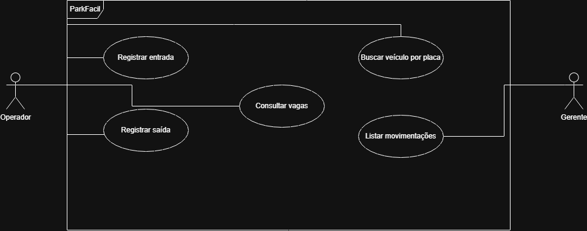

# 4.2.2 Modelagem de Casos de Uso

## Atores

Dois papéis operam o ParkFácil no dia a dia. O ator representa o papel desempenhado no sistema e não a pessoa física[cite: 3].

| Ator | Quem é | O que faz no sistema |
|---|---|---|
| **Operador** | Atendente que fica na guarita do estacionamento[cite: 3] | Registra entradas e saídas de veículos, consulta vagas disponíveis e busca veículos por placa[cite: 3]. |
| **Gerente** | Administrador do estacionamento (Seu Carlos)[cite: 3] | Acompanha o histórico de movimentações financeiras e o total arrecadado no período[cite: 3]. |

## Casos de Uso

A partir dos Requisitos Funcionais levantados na seção 4.2.1, foram definidos os 5 casos de uso do ParkFácil[cite: 3]:

| Caso de Uso | Ator | Requisitos Atendidos |
|---|---|---|
| **Registrar entrada** | Operador[cite: 3] | RF01 e RF02 (o impedimento de entrada indevida é validado neste fluxo)[cite: 3] |
| **Registrar saída** | Operador[cite: 3] | RF03, RF04 e RF05 (o cálculo do valor e a liberação da vaga ocorrem no fluxo)[cite: 3] |
| **Consultar vagas** | Operador[cite: 3] | RF06[cite: 3] |
| **Buscar veículo por placa** | Operador[cite: 3] | RF07[cite: 3] |
| **Listar movimentações** | Gerente[cite: 3] | RF08[cite: 3] |

## Diagrama de Casos de Uso

**Figura 1 – Diagrama de casos de uso do ParkFácil**[cite: 3]

Fonte: Autoria própria (2026)[cite: 3].

A Figura 1 apresenta a fronteira do sistema ParkFácil com os dois atores posicionados do lado externo[cite: 3]:
- O **Operador** relaciona-se com quatro casos de uso: *Registrar entrada*, *Registrar saída*, *Consultar vagas* e *Buscar veículo por placa*[cite: 3].
- O **Gerente** conecta-se ao caso de uso *Listar movimentações*[cite: 3].
- As associações entre os atores e os casos de uso são representadas por linhas contínuas sem ponta de seta[cite: 3].

## Especificação do Caso de Uso Principal

O caso de uso **Registrar entrada** é a funcionalidade principal do sistema, pois garante a alocação organizada de vagas e a emissão do ticket que dá origem ao atendimento no estacionamento[cite: 3].

### Visão Geral

| Campo | Conteúdo |
|---|---|
| **Caso de Uso** | Registrar entrada[cite: 3] |
| **Ator** | Operador[cite: 3] |
| **Pré-condição** | O operador está autenticado no sistema da guarita (RNF02) e o pátio possui vagas cadastradas[cite: 3]. |
| **Pós-condição** | A entrada do veículo é registrada com placa e horário, uma vaga livre é alocada e o ticket de entrada é gerado[cite: 3]. |

### Fluxo Principal

1. O operador informa a placa e o tipo do veículo[cite: 3].
2. O sistema verifica a disponibilidade de vagas e confirma que a placa não está registrada no pátio (RF02)[cite: 3].
3. O sistema atribui uma vaga livre ao veículo (RF01)[cite: 3].
4. O operador confirma o registro de entrada[cite: 3].
5. O sistema registra a movimentação, armazena a data/horário de entrada e gera o ticket de estacionamento[cite: 3].

### Fluxo Alternativo

- **A1 (no passo 1) — Consulta prévia de ocupação:** O operador executa o caso de uso *Consultar vagas* (RF06) para verificar visualmente as vagas livres e retorna ao passo 1 do fluxo principal[cite: 3].

### Fluxos de Exceção

- **E1 (no passo 2) — Estacionamento lotado:** O sistema informa que não há vagas disponíveis para a entrada de novos veículos e encerra o fluxo[cite: 3]. O caso de uso termina sem cumprir a pós-condição[cite: 3].
- **E2 (no passo 2) — Placa já registrada dentro do estacionamento:** O sistema avisa que o veículo correspondente à placa informada já está dentro do pátio (RF02) e impede o novo registro[cite: 3]. O caso de uso termina sem cumprir a pós-condição[cite: 3].

## Rastreabilidade com a Seção 4.2.1

| Requisito | Caso de Uso Associado | Onde é Contemplado |
|---|---|---|
| **RF01** Registrar entrada | Registrar entrada[cite: 3] | Elipse e Passo 3 do fluxo principal de *Registrar entrada*[cite: 3] |
| **RF02** Impedir entrada indevida | (Nenhuma elipse)[cite: 3] | Passo 2 do fluxo principal e fluxos de exceção E1 e E2 de *Registrar entrada*[cite: 3] |
| **RF03** Registrar saída | Registrar saída[cite: 3] | Elipse do caso de uso *Registrar saída*[cite: 3] |
| **RF04** Calcular valor a pagar | (Nenhuma elipse)[cite: 3] | Passo do fluxo principal de *Registrar saída*[cite: 3] |
| **RF05** Liberar vaga | (Nenhuma elipse)[cite: 3] | Passo do fluxo principal de *Registrar saída*[cite: 3] |
| **RF06** Consultar vagas | Consultar vagas[cite: 3] | Elipse e Fluxo Alternativo A1[cite: 3] |
| **RF07** Buscar veículo por placa | Buscar veículo por placa[cite: 3] | Elipse do caso de uso *Buscar veículo por placa*[cite: 3] |
| **RF08** Listar movimentações | Listar movimentações[cite: 3] | Elipse do caso de uso *Listar movimentações*[cite: 3] |

## Análise de Consistência

- **Todo requisito tem lugar?** Sim[cite: 3]. Cinco requisitos tornaram-se elipses próprias[cite: 3]. Os demais (`RF02`, `RF04` e `RF05`) são regras ou passos internos dos fluxos de entrada e saída e estão devidamente mapeados na tabela[cite: 3].
- **Toda elipse tem requisito?** Sim[cite: 3]. Todos os 5 casos de uso correspondem a necessidades diretas levantadas na seção 4.2.1[cite: 3].
- **O que a especificação mudou?** A escrita do fluxo detalhado explicitou a necessidade de validação imediata da placa duplicada no passo 2 (exceção E2) e da consulta prévia de vagas como fluxo alternativo (A1), garantindo que nenhuma entrada indevida avance para a alocação de vaga.