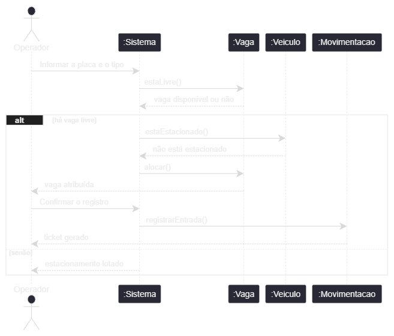

# 4.2.4 Modelagem de Sequência

## Do fluxo às mensagens

O diagrama de sequência descreve a colaboração dinâmica entre os objetos do sistema **ParkFácil** para realizar o cenário principal da especificação do caso de uso **Registrar entrada** (seção 4.2.2). Enquanto o diagrama de atividades (seção 4.2.5) apresenta o fluxo comportamental sob uma perspectiva externa — dividida entre a raia do ator e a raia fechada do Sistema —, o diagrama de sequência detalha o comportamento interno do software, explicitando qual classe executa cada operação, a ordem cronológica de envio das mensagens e as respostas retornadas.

A tradução do fluxo textual da especificação do caso de uso principal em mensagens UML orientadas a objetos segue três diretrizes fundamentais:
1. Cada ação iniciada pelo **Operador** vira uma mensagem direcionada à linha de vida `:Sistema` (representando a interface da guarita e a camada de controle), utilizando a nomenclatura estabelecida no diagrama de atividades (seção 4.2.5), sem parênteses.
2. Cada validação ou processamento executado pelo **Sistema** vira uma mensagem disparada do `:Sistema` para um objeto de classe específico (da seção 4.2.3), nomeada com a operação correspondente acompanhada de parênteses `()`.
3. As respostas de dados ou confirmações de processamento retornam por meio de setas tracejadas para quem solicitou.

| No fluxo da 4.2.2 | Vira a mensagem | De quem para quem | Por quê |
|---|---|---|---|
| **Passo 1:** O operador informa a placa e o tipo do veículo | **Informar a placa e o tipo** | Operador → `:Sistema` | Passo do ator humano que envia os dados de entrada para a interface do sistema. |
| **Passo 2 (parte 1):** O sistema verifica a disponibilidade de vagas | **estaLivre()** e retorno _vaga disponível ou não_ | `:Sistema` → `:Vaga` | Quem sabe se há espaço disponível no pátio é a classe `Vaga`. A resposta decide o fragmento `alt`. |
| **Passo 2 (parte 2):** O sistema confirma que a placa não está registrada (RF02) | **estaEstacionado()** e retorno _não está estacionado_ | `:Sistema` → `:Veiculo` | Quem sabe se o veículo já se encontra dentro do pátio é a classe `Veiculo`. |
| **Passo 3:** O sistema atribui uma vaga livre ao veículo (RF01) | **alocar()** e retorno _vaga atribuída_ | `:Sistema` → `:Vaga` (retorno até Operador) | A operação `alocar()` ocupa a vaga livre no pátio e devolve a confirmação na tela. |
| **Passo 4:** O operador confirma o registro de entrada | **Confirmar o registro** | Operador → `:Sistema` | Ação de confirmação humana do operador na interface da guarita. |
| **Passo 5:** O sistema registra a movimentação, armazena data/hora e gera o ticket | **registrarEntrada()** e retorno _ticket gerado_ | `:Sistema` → `:Movimentacao` (retorno até Operador) | Concretização da pós-condição: grava a data/hora de entrada, vincula veículo e vaga, e gera o ticket. |
| **E1 (no passo 2):** Estacionamento lotado | Fragmento **alt** com as guardas `[há vaga livre]` (passos 2b a 5) e `[senão]` (retorno _estacionamento lotado_) | `:Sistema` → Operador | O quadro `alt` ramifica o fluxo: se não houver vaga livre, o sistema alerta o operador e encerra sem registrar. |
| **A1 e E2:** Consultar vagas e Placa já registrada | Ficam fora do desenho | Nenhuma mensagem | Já estão modelados no Diagrama de Atividades (Figura 4). O diagrama de sequência foca no fluxo principal e na exceção E1 para manter a clareza. |

## Diagrama de sequência

**Figura 5 – Diagrama de sequência de Registrar entrada**

Fonte: Autoria própria (2026).

A Figura 5 apresenta cinco linhas de vida. À esquerda está o ator **Operador**, seguido pela linha de vida **:Sistema** e pelos objetos das classes definidas na seção 4.2.3: `:Vaga`, `:Veiculo` e `:Movimentacao`.

O tempo flui de cima para baixo. Existem seis **mensagens** (setas cheias): duas partem do Operador com os nomes das ações da 4.2.5 (`Informar a placa e o tipo` e `Confirmar o registro`), e quatro partem do `:Sistema` invocando operações nas classes do modelo (`estaLivre()`, `estaEstacionado()`, `alocar()` e `registrarEntrada()`).

Os **retornos** (setas tracejadas) devolvem as respostas de cada consulta ou confirmação de operação até o solicitante. O quadro com a aba **alt** isola a condição de disponibilidade de vagas: no andar superior (`[há vaga livre]`), o fluxo prossegue até a geração do ticket; no andar inferior (`[senão]`), o sistema informa que o estacionamento está lotado.

As classes `Usuario` e `Gerente` não possuem linha de vida neste diagrama porque não participam diretamente das mensagens do caso de uso *Registrar entrada*.

## Rastreabilidade com a 4.2.3

| Mensagem | Chega em | Operação na 4.2.3 | Passo da 4.2.2 |
|---|---|---|---|
| `estaLivre()` | `:Vaga` | `Vaga`, `+ estaLivre(): boolean` | Passo 2 (parte 1) |
| `estaEstacionado()` | `:Veiculo` | `Veiculo`, `+ estaEstacionado(): boolean` | Passo 2 (parte 2) |
| `alocar()` | `:Vaga` | `Vaga`, `+ alocar(): void` | Passo 3 |
| `registrarEntrada()` | `:Movimentacao` | ❓ não existe na 4.2.3 | Passo 5 |
| `Informar a placa e o tipo`, `Confirmar o registro` | `:Sistema` | Nenhuma: são ações do ator `Operador` na 4.2.5 | Passos 1 e 4 |

- **Toda mensagem com parênteses chega em quem tem a operação?** Das quatro mensagens invocadas pelo `:Sistema`, três correspondem exatamente às operações já mapeadas na 4.2.3 (`estaLivre()`, `estaEstacionado()` e `alocar()`).
- **Todo passo tem mensagem?** Sim. Todos os 5 passos do fluxo principal estão representados na ordem cronológica exata, além da exceção E1 tratada no fragmento `alt`.
- **O que o desenho mudou:** Ao detalhar o Passo 5 (registrar a movimentação de entrada), identificou-se que a classe `Movimentacao` possuía operações para o encerramento e cálculo na saída (`encerrar()`, `calcularPermanencia()`, `calcularValor()`), mas não tinha uma operação explícita para registrar a entrada.

❓ **Para a próxima revisão da 4.2.3:** Adicionar a operação `+ registrarEntrada(): void` na classe `Movimentacao`.
