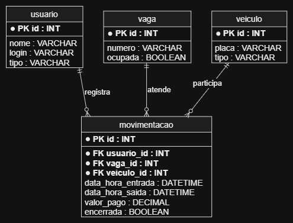

# 4.2.6 Modelagem de Banco de Dados

## Das classes às tabelas

O banco de dados guarda o que o **ParkFácil** precisa lembrar depois de fechado ou reiniciado. O ponto de partida é o diagrama de classes da seção 4.2.3: as classes definem as tabelas, os atributos viram colunas, e as associações definem as chaves estrangeiras.

Seguindo as regras de tradução para o modelo relacional:
- Cada classe concreta vira uma tabela em minúsculas, sem acento e com sublinhado (`snake_case`), recebendo uma chave primária `id: INT`.
- As operações da 4.2.3 (`autenticar()`, `alocar()`, `estaLivre()`, `calcularValor()`, etc.) não viram colunas, pois representam comportamento executado pelo programa e não dados armazenados.
- Como o banco relacional não possui herança, as classes filhas `Operador` e `Gerente` foram unificadas na tabela da superclasse `usuario`, diferenciadas pela coluna `tipo`.

| Na 4.2.3 | Vira | Em qual tabela | Por quê |
|---|---|---|---|
| Herança: `Operador` e `Gerente` são tipos de `Usuario` (atributos `nome` e `login`) | Tabela `usuario` com `id`, `nome`, `login` e a coluna nova `tipo` | `usuario` | O banco não tem triângulo de herança. Como as classes filhas não possuem atributos próprios além do perfil, cabem juntas em `usuario`, e `tipo` diferencia operador de gerente |
| Classe `Vaga`, com `numero` e `ocupada` | Tabela `vaga` com `id`, `numero` e `ocupada` | `vaga` | Cada vaga física do pátio é uma linha identificada pelo seu `id` |
| Classe `Veiculo`, com `placa` e `tipo` | Tabela `veiculo` com `id`, `placa` e `tipo` | `veiculo` | Guarda os veículos cadastrados que passam pelo estacionamento |
| Classe `Movimentacao`, com `dataHoraEntrada`, `dataHoraSaida`, `valorPago` e `encerrada` | Tabela `movimentacao` com `id`, `data_hora_entrada`, `data_hora_saida`, `valor_pago` e `encerrada` | `movimentacao` | Substitui o controle em papel na guarita; cada linha registra uma passagem completa de entrada e saída |
| Associação: um `Operador` registra `0..*` `Movimentacao` | Chave estrangeira `usuario_id` | `movimentacao` | Um operador registra várias movimentações ao longo do turno, mas cada movimentação é registrada por um único operador (lado do muitos fica com a FK) |
| Associação: uma `Vaga` atende `0..*` `Movimentacao` | Chave estrangeira `vaga_id` | `movimentacao` | A mesma vaga é reutilizada por vários carros ao longo do dia, mas cada movimentação ocupa uma única vaga por vez |
| Associação: um `Veiculo` participa de `0..*` `Movimentacao` | Chave estrangeira `veiculo_id` | `movimentacao` | Um mesmo carro pode entrar e sair várias vezes em dias diferentes, mas cada movimentação pertence a um único veículo |
| Operações: `autenticar()`, `alterarValorHora()`, `alocar()`, `liberar()`, `estaLivre()`, `estaEstacionado()`, `calcularPermanencia()`, `calcularValor()`, `encerrar()` | Nada | Nenhuma | Operação é comportamento do código, não dado persistido no banco |

## Diagrama do banco de dados

**Figura 6 – Diagrama do banco de dados do ParkFácil**

Fonte: Autoria própria (2026).

A Figura 6 apresenta o modelo relacional do **ParkFácil**, composto por quatro tabelas (`usuario`, `vaga`, `veiculo` e `movimentacao`), quatro chaves primárias (`PK id`) e três chaves estrangeiras (`FK`).

A tabela `usuario` armazena os colaboradores da guarita e a gerência, utilizando a coluna `tipo` para distinguir os perfis sem duplicar estrutura. A tabela `vaga` controla o identificador visual (`numero`) e o status atual (`ocupada`) de cada posição do pátio, enquanto `veiculo` mantém a `placa` e a categoria (`tipo`) dos automóveis.

No centro do relacionamento está a tabela `movimentacao`, que concentra as três chaves estrangeiras e se liga às demais tabelas com cardinalidade **1 para muitos** (dois tracinhos no lado de `usuario`, `vaga` e `veiculo`; bolinha e pé de galinha no lado de `movimentacao`). Lendo nos dois sentidos: um usuário registra zero ou várias movimentações, e cada movimentação é registrada por um único usuário; uma vaga atende zero ou várias movimentações, e cada movimentação utiliza uma única vaga; um veículo participa de zero ou várias movimentações, e cada movimentação refere-se a um único veículo.

## Rastreabilidade com a 4.2.3

| Na 4.2.3 | No banco | Confere |
|---|---|---|
| Classe `Usuario` + heranças `Operador` e `Gerente` | Tabela `usuario` (`id`, `nome`, `login`, `tipo`) | Sim (unificada com coluna discriminadora `tipo`) |
| Classe `Vaga` | Tabela `vaga` (`id`, `numero`, `ocupada`) | Sim |
| Classe `Veiculo` | Tabela `veiculo` (`id`, `placa`, `tipo`) | Sim |
| Classe `Movimentacao` | Tabela `movimentacao` (`id`, `usuario_id`, `vaga_id`, `veiculo_id`, `data_hora_entrada`, `data_hora_saida`, `valor_pago`, `encerrada`) | Sim |
| Ligações entre `Operador`, `Vaga`, `Veiculo` e `Movimentacao` | Chaves estrangeiras `usuario_id`, `vaga_id` e `veiculo_id` em `movimentacao` | Sim |

### Teste com as linhas da Figura 3 (Operação na guarita)

Abaixo estão os sete objetos simulados no teste da seção 4.2.3 convertidos em registros reais nas tabelas do banco:

**Tabela `usuario`**

| id (PK) | nome | login | tipo |
|---|---|---|---|
| 1 | João Silva | joao.op | operador |
| 2 | Carlos Eduardo | carlos.ger | gerente |

**Tabela `vaga`**

| id (PK) | numero | ocupada |
|---|---|---|
| 1 | A-01 | true |

**Tabela `veiculo`**

| id (PK) | placa | tipo |
|---|---|---|
| 1 | ABC-1234 | Passeio |
| 2 | XYZ-9876 | Passeio |

**Tabela `movimentacao`**

| id (PK) | usuario_id (FK) | vaga_id (FK) | veiculo_id (FK) | data_hora_entrada | data_hora_saida | valor_pago | encerrada |
|---|---|---|---|---|---|---|---|
| 1 | 1 | 1 | 1 | 2026-10-20 08:00 | 2026-10-20 10:00 | 10.00 | true |
| 2 | 1 | 1 | 2 | 2026-10-20 10:30 | null | 0.00 | false |

- **Toda classe tem tabela, ou a decisão escrita?** Sim. As quatro classes base (`Usuario`, `Vaga`, `Veiculo` e `Movimentacao`) viraram tabelas, e a decisão de unificar as subclasses `Operador` e `Gerente` em `usuario` foi documentada.
- **Todo atributo tem coluna?** Sim. Todos os atributos das classes foram convertidos para colunas no padrão `snake_case`, e nenhuma operação foi incluída.
- **Toda associação tem chave estrangeira?** Sim. As três associações do diagrama de classes viraram as chaves estrangeiras `usuario_id`, `vaga_id` e `veiculo_id` dentro de `movimentacao`.
- **O que a tradução mudou?** Seis classes viraram quatro tabelas por conta da resolução da herança, surgindo a coluna nova `tipo` em `usuario` (que não existia como atributo na 4.2.3) para diferenciar operadores de gerentes.